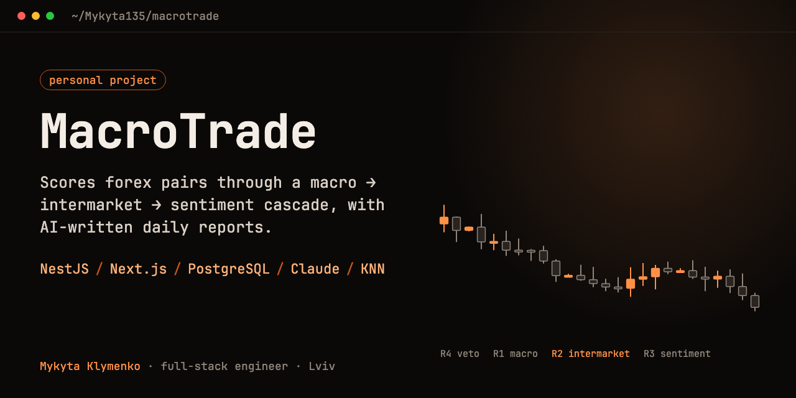
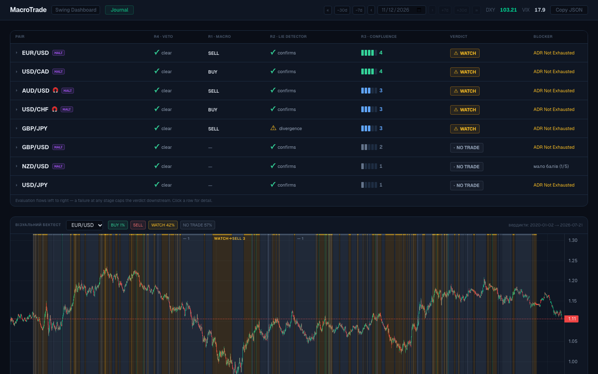
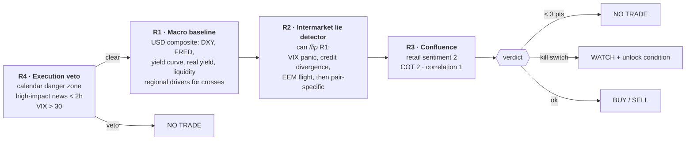
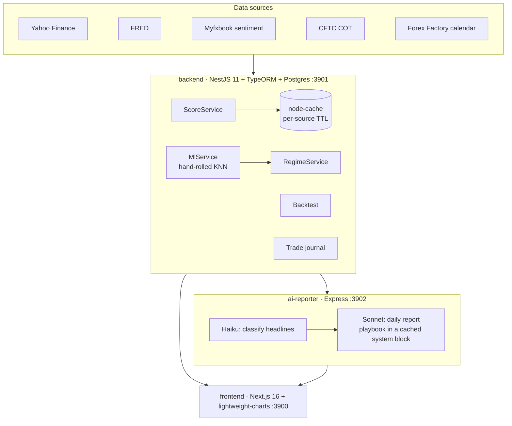

A personal swing-trading dashboard. Every day it pulls macro data, intermarket signals, positioning and the economic calendar, runs each forex pair through a scoring cascade, and says **BUY / SELL / WATCH / NO TRADE**, plus what has to change before a blocked pair unlocks. An AI reporter then writes the day's narrative from the same data.

It is a research tool I built for myself, not financial advice and not an order-executing bot.

> **About the git history.** I have been building MacroTrade since April 2026 as a personal tool. It was not under version control until I published it in November 2026, so the history here starts with that first commit.



## How a pair gets scored

The heart of the system is [`score.service.ts`](backend/src/score/score.service.ts): a hierarchical cascade where a failure at any stage caps the verdict downstream.



Order inside R2 is load-bearing: global panic checks run before regional ones, because a VIX spike should override what the DAX says about the euro.

## Architecture



- **Caching per source:** macro and sentiment every 15 min, FRED every 4 h, the calendar hourly with a 7-day stale fallback, COT keyed to the next CFTC release.
- **ML without a library:** `data/pipeline` builds features and labels from history and trains a KNN (plain euclidean distance over normalised features) that the backend loads at boot.
- **Defensive LLM parsing:** the reporter strips fences, walks brace depth to find the outermost JSON, and never persists a degraded report, so a bad parse is not re-served from disk.

## Run it

Needs Node 20+, Postgres, a FRED API key, and an Anthropic key for the reporter.

```bash
cd backend && cp .env.example .env && npm i && npm run start:dev   # :3901
cd frontend && cp .env.example .env.local && npm i && npm run dev   # :3900
cd ai-reporter && cp .env.example .env && npm i && npm run dev      # :3902 (start after the backend)
```

Tests: `cd backend && npm test`.

## Not in this repo

- Historical OHLCV exports and scraped calendar CSVs: they are licensed or scraped data, so they stay local. The pipeline scripts that consume them are here.
- The Forex Factory scraper: a third-party GPL-3.0 project I ran locally for a one-time calendar import.

More detail (in Ukrainian): [docs/](docs/).
